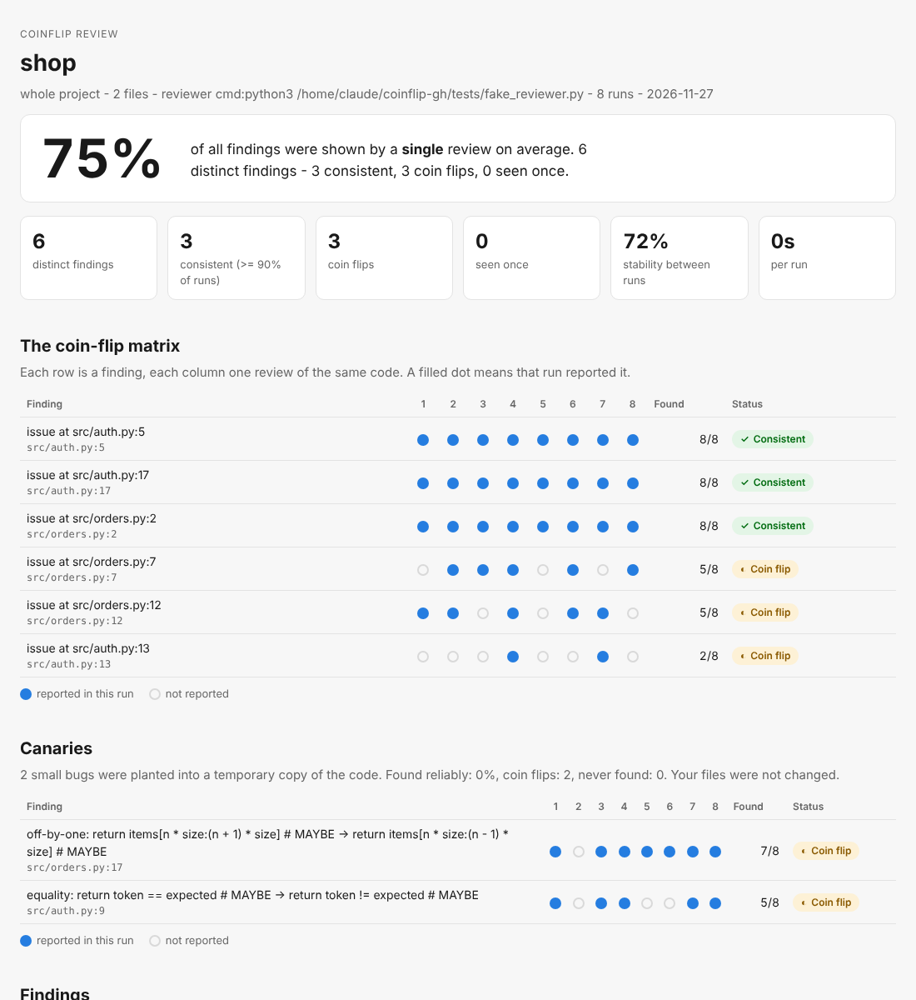

# coinflip

**Is your AI code review a coin flip?**

Run the same AI review on the same code twice and you get two different lists.
Some findings come back every time. Others appear once and vanish on the next run -
so whether you hear about them is luck.

coinflip runs your AI reviewer several times on your project and tells you which is which:

```text
coinflip 0.2.3  |  review: my-shop (diff vs main, 6 files)  |  reviewer: claude  |  5 runs

  >> 11 distinct findings - 4 consistent, 5 coin flips, 2 seen once
     a single run showed on average 52% of them

  Consistent          4   reported in >= 90% of runs - act on these
  Coin flips          5   reported only sometimes - worth a human look
  Seen once           2   reported in a single run
  Stability         41%   overlap of findings between two runs

  CONFIDENCE         STATUS     SEVERITY  WHERE                        FINDING
  ##########    5/5  CONSISTENT high      src/orders.py:42             SQL built by string concatenation
  ##########    5/5  CONSISTENT high      src/auth.py:88               Token expiry never checked
  ######....    3/5  COIN FLIP  medium    src/cart.py:17               Discount applied twice for bundles
  ##........    1/5  ONCE       low       src/util.py:5                Off-by-one in pagination window
```
<sub>Illustrative output. Your numbers will differ - that is the point.</sub>

- **Your project, untouched.** Every review runs on a temporary copy that is deleted afterwards.
- **No API keys, no account.** coinflip drives the AI CLI you already use and are logged in to:
  Claude Code, Codex, Gemini CLI, Ollama - or any command.
- **A better review, not just a number.** Every finding gets a confidence score, so you know
  what to fix right away and what needs a second look.

## The easy way: inside Claude Code

Install the plugin once - it then works in the terminal **and** in the VS Code extension
(both share the same plugins).

**Terminal (Claude Code CLI):**

```text
/plugin marketplace add DerChris2011/coinflip
/plugin install coinflip@coinflip
```

**VS Code extension:** paste this into your browser's address bar - it opens VS Code
straight at the install dialog:

```text
vscode://anthropic.claude-code/install-plugin?plugin=coinflip&marketplace=DerChris2011/coinflip
```

Or type `/plugins` in the Claude Code panel, add `DerChris2011/coinflip` in the
**Marketplaces** tab, then install **coinflip** in the **Plugins** tab.

**Then, in any project:**

```text
/coinflip:review
```

The skill picks what to review (your uncommitted changes, your branch, or the whole project),
runs the reviews in the background, then opens every consistent and coin-flip finding in your
code and tells you what to fix, what is worth a look and what is probably noise.
It only needs [uv](https://docs.astral.sh/uv/) - and asks before installing it.

You can also just say: *"review my changes with coinflip, 10 runs, with canaries"*.

<details>
<summary>Install fails with an error about another marketplace, or no plugin support at all?</summary>

If installing reports `Failed to load marketplace "claude-plugins-official"`, refresh that
marketplace first: `claude plugin marketplace update claude-plugins-official`.

Without plugin support, copy the skill into your personal skills folder and run it as `/coinflip`:

```bash
# macOS / Linux
mkdir -p ~/.claude/skills/coinflip && curl -fsSL -o ~/.claude/skills/coinflip/SKILL.md \
  https://raw.githubusercontent.com/DerChris2011/coinflip/main/standalone-skill/coinflip/SKILL.md
```
```powershell
# Windows (PowerShell)
New-Item -ItemType Directory -Force "$HOME\.claude\skills\coinflip" | Out-Null
Invoke-WebRequest https://raw.githubusercontent.com/DerChris2011/coinflip/main/standalone-skill/coinflip/SKILL.md -OutFile "$HOME\.claude\skills\coinflip\SKILL.md"
```
</details>

## Install the command-line tool

You need [uv](https://docs.astral.sh/uv/getting-started/installation/) and at least one AI CLI.

```bash
# macOS / Linux
curl -LsSf https://astral.sh/uv/install.sh | sh
# Windows (PowerShell)
powershell -ExecutionPolicy ByPass -c "irm https://astral.sh/uv/install.ps1 | iex"
```

Then run it straight from GitHub - nothing else to install:

```bash
uvx --from git+https://github.com/DerChris2011/coinflip coinflip review
```

Or install it once (`pipx` works too):

```bash
uv tool install git+https://github.com/DerChris2011/coinflip
coinflip review
```

## Use it on your project

Run it inside your project folder (or pass the path):

```bash
coinflip review                      # the whole project, 5 runs
coinflip review --diff main          # only your changes - like a PR review
coinflip review -n 10 -r codex       # more runs, another reviewer
coinflip review --include "src/payments/**"
```

Without `-r`, coinflip uses the first AI CLI it finds (claude, codex, gemini).
`coinflip reviewers` shows what is installed.

### How good is the reviewer on *my* code? Canaries.

```bash
coinflip review --canary 8
```

coinflip plants 8 small bugs of different kinds into the temporary copy - a flipped comparison,
a swapped `&&`/`||`, a forgotten `await`, an accumulator that overwrites, an off-by-one, a dropped
escaping call - and checks how often the reviewer finds each kind:

```text
  Canaries            8   bugs planted into a temporary copy of your code
    Reliability     50%   canaries found in >= 90% of runs
    Coin flips        1   canaries found only sometimes (3 never)
    Recall/run      58%   all runs together 63%
    By kind       equality 100%  |  missing await 100%  |  boolean 0%  |  accumulator 40%  |  ...
```

The kinds a reviewer never catches are its blind spots on your code - cover those with tests.
Canaries are spread across kinds, kept apart from each other, never planted into test code, and
kept away from spots that earlier reviews of the project already flagged - so run a normal review first.

Canaries never show up in your findings list, and your files are never changed.
With `--diff`, canaries go into the changed lines. Canaries are simple logic slips - a good
indicator of how attentive the reviewer is, not a full security audit.

## What the numbers mean

| | |
|---|---|
| **Consistent** | Reported in at least 90 % of runs. Safe to act on. |
| **Coin flip** | Reported in some runs but not others. A single review might or might not have told you. |
| **Seen once** | Reported in exactly one run. Often noise - sometimes the one real catch. |
| **Single-run coverage** | How much of everything found, one review on its own would have shown you. |
| **Stability** | Average overlap (Jaccard) of the findings of two runs. 100 % = always the same list. |

Findings from different runs are merged when they point at the same file within 3 lines.

## Reviewers

| Spec | Runs |
|---|---|
| `claude`, `claude:<model>` | `claude -p` (Claude Code), read-only tools |
| `codex`, `codex:<model>` | `codex exec --sandbox read-only` |
| `gemini`, `gemini:<model>` | Gemini CLI |
| `ollama:<model>` | `ollama run <model>` - fully local, code is sent inside the prompt |
| `cmd:<command line>` | anything that reads the prompt on stdin and answers on stdout |

Agentic CLIs (Claude Code, Codex, Gemini) read the project copy themselves, so large projects work.
Local models get the code inside the prompt - combine them with `--diff` or `--include`.
If your CLI version needs other flags, use `cmd:`, e.g. `-r "cmd:claude -p --model sonnet"`.

**Cost:** every run is one full review by your CLI, on your plan or API key.
`--diff` keeps runs small and fast; 5 runs is a good default.

## The leaderboard benchmark

For comparing reviewers head to head, coinflip ships `pyshop-v1`: a small shop backend
with **15 planted bugs** (9 security, 6 logic) and a bug-free twin to count false alarms.

```bash
coinflip bench run -r claude -r codex -r gemini      # 10 runs each + 3 on the clean twin
coinflip compare -f markdown                          # leaderboard of all benchmark sessions
coinflip bench show pyshop                            # the planted bugs (spoilers!)
```

Every reviewer gets the byte-identical prompt in an empty folder, with no hints about the bugs.
Share your results: open a pull request adding your `results.json` to `results/pyshop-v1/`.

## The HTML report

Every review also writes a self-contained HTML report - one file, no external resources,
light and dark mode. Its centrepiece is the **coin-flip matrix**: one row per finding, one
column per run, a dot where that run reported it.


<sub>Example from the test reviewer.</sub>

```bash
coinflip review --open                          # open it in the browser when done
coinflip report --open                          # open the latest report again
coinflip report -f html -o coinflip-report.html # save a copy to share
```

## Sessions

Every run is stored in `~/.coinflip/sessions/` (override with `COINFLIP_HOME` or `-o`) with the
exact prompt, every raw answer and `results.json` - never inside your project.

```bash
coinflip report                 # the latest session again
coinflip report -f markdown     # ready to paste into a PR, an issue or a post
```

`report` re-scores from the raw answers, so you never pay twice.

## Roadmap

- GitHub Action: post consistent and coin-flip findings as a PR comment
- More benchmarks (TypeScript, Java, C#) and seeded bug placement
- Security canaries (injection, missing auth checks)
- Token and cost tracking per run

## Development

```bash
uv venv && uv pip install -e ".[dev]"
uv run pytest
```

## License

MIT
