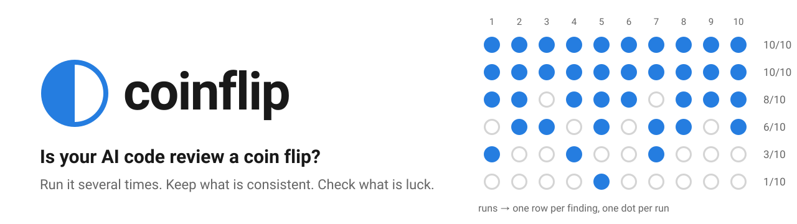
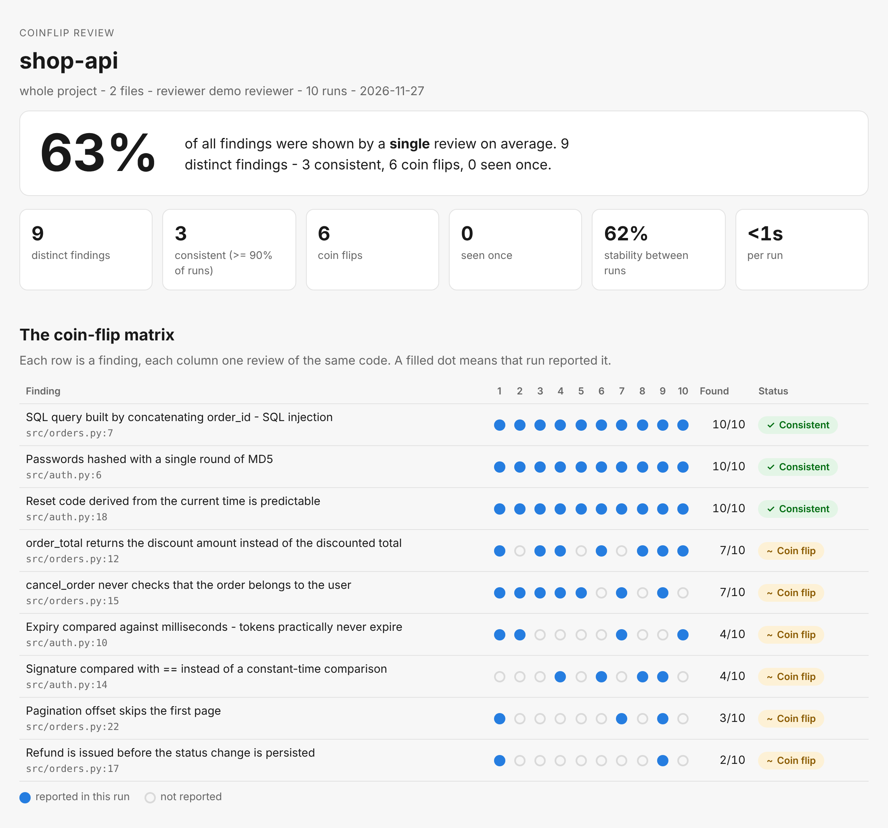
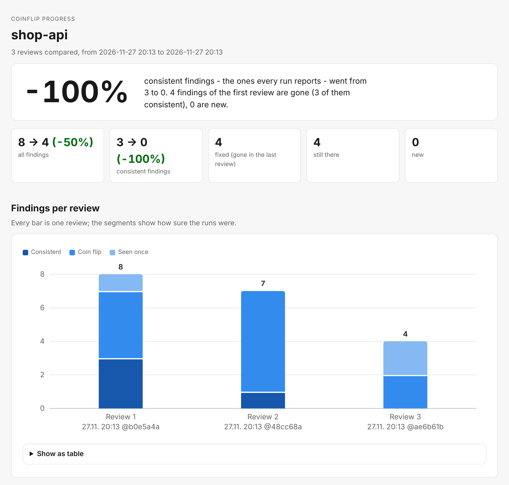
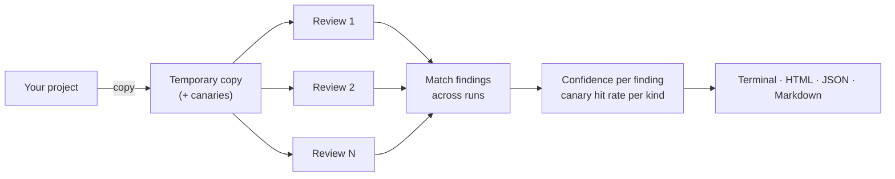

<div align="center">

<picture>
  <source media="(prefers-color-scheme: dark)" srcset="docs/banner-dark.svg">
  
</picture>

**Run your AI code review several times. Keep what comes back every time. Check what is luck.**

Confidence score for every finding · finds the reviewer's blind spots on *your* code ·
works with Claude Code, Codex, Gemini CLI and local models · no API key, no account

[](https://github.com/DerChris2011/coinflip/actions/workflows/ci.yml)
[](LICENSE)
[](https://www.python.org/)
[](#quick-start-in-claude-code)
[](#privacy-and-cost)

</div>

---

Ask an AI to review the same code twice and you get two different lists. Some problems come
back every time. Others show up once and are gone on the next run - so whether you hear about
them is **luck**. coinflip makes that visible: it runs the review several times on a temporary
copy of your project and tells you, for every finding, how often it came back.

```text
You:     /coinflip:review
Claude:  Reviewing the whole project (38 files) 5 times on a temporary copy - your files stay untouched.
         ...
         25 findings over 5 reviews: 3 came back every time, 13 are a coin flip, 9 showed up once.
         A single review would have shown you only 48 % of them.

         Fix these (5/5, confirmed in the code)
           src/tools/files.ts:82   a failed upload keeps the import wait open for up to 120 s
           src/setup.ts:137        shell command built from a path that is only partly escaped
         Worth a look (coin flips I judge to be real)
           src/client.ts:74        API calls have no timeout - a hanging LightBurn hangs the tool
           ...
```

<sub>Condensed and translated from a real run of coinflip on [LightBurn MCP](https://github.com/DerChris2011/Lightburn_MCP) (38 source files, Claude Code as reviewer).</sub>

## Table of contents

- [What it does](#what-it-does)
- [What it does not do](#what-it-does-not-do)
- [Quick start in Claude Code](#quick-start-in-claude-code)
- [Reading the result](#reading-the-result)
- [Canaries: how good is the reviewer on your code?](#canaries-how-good-is-the-reviewer-on-your-code)
- [The HTML report](#the-html-report)
- [Did the fixes work? Progress reports](#did-the-fixes-work-progress-reports)
- [Without Claude Code: the command line](#without-claude-code-the-command-line)
- [Reviewers](#reviewers)
- [Benchmark and leaderboard](#benchmark-and-leaderboard)
- [How it works](#how-it-works)
- [Privacy and cost](#privacy-and-cost)
- [Troubleshooting](#troubleshooting)
- [Development](#development)
- [License](#license)

## What it does

| | |
|---|---|
| 🎯 **Confidence per finding** | Every finding is marked *consistent* (≥ 90 % of runs), *coin flip* or *seen once*. Fix the first, check the second. |
| 📉 **Shows what one review misses** | "A single review showed you 48 % of all findings" - the number nobody tells you. |
| 🐤 **Canaries** | Plants small bugs into a temporary copy and measures which kinds the reviewer catches on *your* code - and which never. |
| 🔀 **Reviews what you are working on** | Your uncommitted changes, your branch against `main`, or the whole project. |
| 🧩 **One command in Claude Code** | `/coinflip:review` picks the scope, runs everything, then opens each finding in your code and judges it. |
| 🟦 **The coin-flip matrix** | A self-contained HTML report: one row per finding, one dot per run. Easy to share. |
| 📈 **Progress reports** | Review, fix, review again - `/coinflip:progress` shows with charts how the findings went down. |
| 🏁 **Benchmark** | 15 planted bugs plus a bug-free twin, to compare reviewers head to head. |

## What it does not do

coinflip **never changes your files**. Every review runs on a temporary copy that is deleted
afterwards, and nothing is written into your project. It is not a linter or a security scanner
of its own: it measures - and improves - the AI reviewer you already use. The Claude Code skill
fixes findings only when you ask it to.

## Quick start in Claude Code

**You need:** [Claude Code](https://code.claude.com) (terminal or VS Code) and
[uv](https://docs.astral.sh/uv/) - the skill offers to install uv if it is missing.

**1. Install the plugin once.** It then works in the terminal *and* in the VS Code extension.

In the terminal version of Claude Code:

```text
/plugin marketplace add DerChris2011/coinflip
/plugin install coinflip@coinflip
```

In VS Code, paste this into your browser's address bar - it opens the install dialog:

```text
vscode://anthropic.claude-code/install-plugin?plugin=coinflip&marketplace=DerChris2011/coinflip
```

Or from any shell: `claude plugin marketplace add DerChris2011/coinflip` and
`claude plugin install coinflip@coinflip`.

**2. Open a project and run it:**

```text
/coinflip:review
```

That's it. The skill decides what to review, runs 5 reviews in the background (3 in parallel,
a few minutes), opens every consistent and coin-flip finding in your code and tells you what to
fix, what is worth a look and what is probably noise.

**Things you can say instead:**

- *"Review my changes with coinflip."*
- *"Run coinflip on src/payments with 10 runs."*
- *"Measure how good the reviewer is on this project, with 8 canaries."*
- *"Open the coinflip report."*

To update later, in a shell: `claude plugin marketplace update coinflip` and
`claude plugin update coinflip@coinflip`, then restart Claude Code. `claude plugin list` shows
the installed version.

## Reading the result

<picture>
  <source media="(prefers-color-scheme: dark)" srcset="docs/report-dark.png">
  
</picture>

<sub>Example report from a demo project.</sub>

| | What it means | What to do |
|---|---|---|
| **Consistent** | Reported in at least 90 % of runs | Act on it |
| **Coin flip** | Reported in some runs, not in others | Worth a human look - one review may or may not have told you |
| **Seen once** | Reported in exactly one run | Often noise, sometimes the one real catch |
| **Single-run coverage** | How much of everything found one review showed on its own | The cost of running a review only once |
| **Stability** | Average overlap of the findings of two runs | 100 % = always the same list |

Findings from different runs are merged when they point at the same spot (within 3 lines).
Two findings of the same run are never merged - the reviewer saw two problems.

## Canaries: how good is the reviewer on your code?

```text
/coinflip:review with 8 canaries        (or: coinflip review --canary 8)
```

coinflip plants small bugs into the temporary copy and checks how often the reviewer finds each
one. On LightBurn MCP, the reviewer found 3 of 5 planted bugs in **every** run - and the other 2
in **none**. More runs would not have helped: those are blind spots, and a unit test is the
better tool there.

| Kind | Example |
|---|---|
| equality | `a === b` → `a !== b` |
| comparison | `x <= 0` → `x < 0` |
| boolean | `a && b` → `a \|\| b` |
| negation | `if (!file)` → `if (file)` |
| constant | `return true` → `return false` |
| off-by-one | `argv[i + 1]` → `argv[i - 1]` |
| missing await | `await save(x)` → `save(x)` |
| accumulator | `total += x` → `total = x` |
| dropped escaping | `encodeURIComponent(id)` → `id` |
| loop control | `break` ↔ `continue` (Python) |

Canaries are spread across kinds, kept apart from each other, never planted into test code, and
kept away from spots that earlier reviews already flagged - so run a normal review first. With
`--diff`, they go into your changed lines. They never appear in your findings list.

## The HTML report

Every session writes a self-contained `report.html`: one file, no external resources, light and
dark mode, with the matrix, the canary results, a code snippet for every finding and every raw
answer - so each number can be checked.

```bash
coinflip report --open                            # open the latest report
coinflip report -f html -o coinflip-report.html   # save a copy to share
coinflip report -f markdown                       # a table for a pull request or issue
```

## Did the fixes work? Progress reports

Review, fix what it found, review again - then compare:

```text
/coinflip:progress
```

The skill lists the reviews of the project (with date, commit and scope), asks which ones to
compare - all, the last two, first and last, or specific ones - and opens a report with charts:
findings per review by confidence and by severity, how reliable each review was, what happened
to each finding (fixed, still there, new) and findings per file. It only runs when you call it,
and only when the project has at least two reviews.

<picture>
  <source media="(prefers-color-scheme: dark)" srcset="docs/progress-dark.png">
  
</picture>

<sub>Example from a demo project: three reviews, two rounds of fixes.</sub>

```bash
coinflip sessions                 # the reviews of this project, numbered
coinflip progress 1 3 --open      # compare review 1 and 3
coinflip progress --last 2        # the last two
```

Counts per review are exact. Following one finding from review to review is a best guess -
lines move when code changes and every run words its findings differently - and the report
says so. Compare reviews with the same scope and number of runs for a fair picture.

## Without Claude Code: the command line

Install [uv](https://docs.astral.sh/uv/getting-started/installation/):

```bash
# macOS / Linux
curl -LsSf https://astral.sh/uv/install.sh | sh
```

```powershell
# Windows (PowerShell)
powershell -ExecutionPolicy ByPass -c "irm https://astral.sh/uv/install.ps1 | iex"
```

Then run coinflip straight from GitHub, inside your project:

```bash
uvx --from git+https://github.com/DerChris2011/coinflip coinflip review
```

Or install it once: `uv tool install git+https://github.com/DerChris2011/coinflip`.

```text
coinflip review [PATH]               Review a project N times (default 5)
    --diff REF                       only your changes against a git ref, e.g. main or HEAD
    --include GLOB                   only these files, e.g. "src/payments/**"
    --canary N                       plant N canaries into the temporary copy
    -r SPEC                          reviewer (default: first of claude, codex, gemini found)
    -n RUNS  -j PARALLEL             number of runs, runs at the same time
    --open                           open the HTML report when done
coinflip report [SESSION] [-f text|markdown|json|html] [-o FILE] [--open]
coinflip sessions [PATH]             the review sessions of a project, numbered
coinflip progress [N ...] [--last N] [-f html|text|json] [-o FILE] [--open]
coinflip bench run -r SPEC ...       run the benchmark
coinflip compare [-f markdown]       leaderboard of all benchmark sessions
coinflip bench list | show NAME | export NAME DEST
coinflip reviewers                   which reviewer CLIs are installed
```

## Reviewers

coinflip never talks to an AI API itself. It drives the CLI you already use and are logged in to.

| Reviewer | `-r` | Notes |
|---|---|---|
| Claude Code | `claude`, `claude:<model>` | read-only tools; reads the project copy itself |
| OpenAI Codex | `codex`, `codex:<model>` | read-only sandbox |
| Gemini CLI | `gemini`, `gemini:<model>` | |
| Ollama | `ollama:<model>` | fully local; code is sent inside the prompt - use `--diff` or `--include` |
| Anything else | `cmd:<command line>` | any command that reads the prompt on stdin and answers on stdout |

If your CLI version needs other flags, use `cmd:`, e.g. `-r "cmd:claude -p --model sonnet"`.

## Benchmark and leaderboard

To compare reviewers head to head, coinflip ships `pyshop-v1`: a small shop backend (~450 lines
of Python) with **15 planted bugs** - 9 security, 6 logic, from textbook SQL injection to an
expiry written in milliseconds but checked in seconds - and a bug-free twin to count false alarms.

```bash
coinflip bench run -r claude -r codex -r gemini     # 10 runs each + 3 on the clean twin
coinflip compare -f markdown                         # the leaderboard
coinflip bench show pyshop                           # the planted bugs (spoilers!)
```

Every reviewer gets the byte-identical prompt in an empty folder, with no hint about the bugs.
**Share your results:** open a pull request adding your `results.json` to `results/pyshop-v1/`.

## How it works



- **The copy** contains your tracked and untracked (not ignored) files. Canaries are planted
  only there. It is deleted when the session ends.
- **Every run** gets the identical prompt and asks for findings as JSON (file, line, severity,
  title). Agentic CLIs read the copy themselves, so large projects work.
- **Matching** groups findings from different runs that point at the same spot. A finding counts
  for a canary only within 2 lines of it.
- **Sessions** keep the exact prompt and every raw answer, so `coinflip report` can re-score
  without paying for the runs again.

## Privacy and cost

- **No API key, no account, no server.** coinflip runs locally and uses your CLI, on your plan.
- Your code goes only where your CLI sends it anyway.
- Sessions are stored in `~/.coinflip/sessions` (override with `COINFLIP_HOME` or `-o`) - never
  inside your project.
- **Every run is one full review.** 5 runs cost 5 reviews. `--diff` keeps them small and fast.

## Troubleshooting

| Symptom | What's going on |
|---|---|
| `/plugin isn't available in this environment` | That is the VS Code extension: use the install link above, or type `/plugins` there. |
| `Failed to load marketplace "claude-plugins-official"` | A stale copy of another marketplace. Run `claude plugin marketplace update claude-plugins-official` and install again. |
| No plugin support at all | Copy the skill file and run it as `/coinflip` - see below. |
| A run seems to hang | Agentic reviews take 1-3 minutes, sometimes more. coinflip prints `still working` every 30 s and gives a run up after 10 minutes (`--timeout`). |
| `no readable JSON` | The reviewer answered without the requested JSON. Check its raw answer in the HTML report; for other CLIs adjust the flags with `cmd:`. |
| `nothing to review` with `--diff main` | You are on `main` without changes. Use `coinflip review` for the whole project or `--diff HEAD~3`. |

<details>
<summary>Install the skill without the plugin system</summary>

```bash
# macOS / Linux
mkdir -p ~/.claude/skills/coinflip && curl -fsSL -o ~/.claude/skills/coinflip/SKILL.md \
  https://raw.githubusercontent.com/DerChris2011/coinflip/main/standalone-skill/coinflip/SKILL.md
```

```powershell
# Windows (PowerShell)
New-Item -ItemType Directory -Force "$HOME\.claude\skills\coinflip" | Out-Null
Invoke-WebRequest https://raw.githubusercontent.com/DerChris2011/coinflip/main/standalone-skill/coinflip/SKILL.md -OutFile "$HOME\.claude\skills\coinflip\SKILL.md"
```

Start a new Claude Code session and type `/coinflip`.
</details>

## Development

```bash
git clone https://github.com/DerChris2011/coinflip.git
cd coinflip
uv run --extra dev pytest          # tests run against a scripted fake reviewer
uv run coinflip review --help
```

Python 3.11+, no runtime dependencies. CI runs on Windows, macOS and Linux. The Claude Code
plugin lives in [`plugins/coinflip`](plugins/coinflip), the marketplace in
[`.claude-plugin`](.claude-plugin). Issues and pull requests are welcome.

## License

MIT © Christoph Fandrich. Not affiliated with Anthropic, OpenAI or Google.
